# Yuqi Guo's Portfolio Platform

[](LICENSE)

A modern Next.js portfolio application for showcasing projects, blogs, CV, visitor analytics, and an AI-powered portfolio assistant. The site is designed as both a personal portfolio and a microservice-backed engineering platform, with serverless frontend APIs, Supabase-backed content storage, Kafka-based event fan-out, OpenSearch search, pgvector RAG indexing, notification delivery, and a real-time visitor analytics pipeline.

**Production:** https://www.yuqi.site

---

## Architecture

<!-- architecture:start -->
<!-- Generated by scripts/render-architecture-views.mjs. Edit the JSON sources in docs/architecture/, then run `npm run docs:architecture`. -->

<p align="center">
  <a href="public/diagrams/overview.svg">
    <picture>
      <source media="(prefers-color-scheme: dark)" srcset="public/diagrams/overview-dark.svg">
      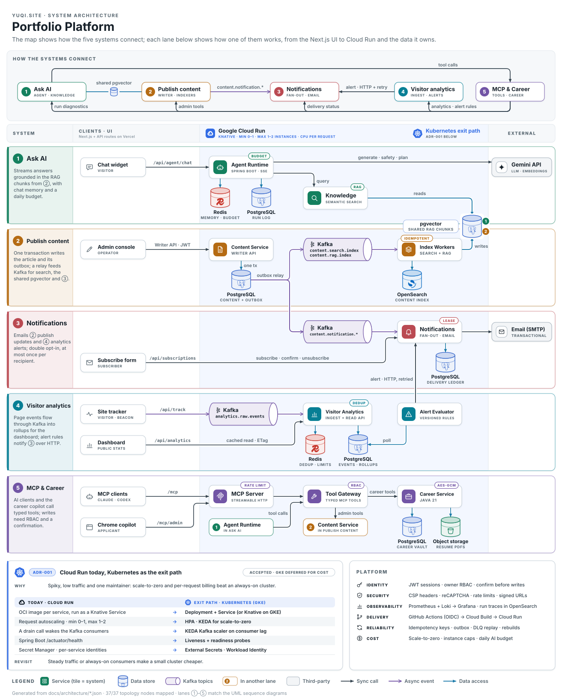
    </picture>
  </a>
</p>

<p align="center"><a href="https://www.yuqi.site/architecture"><b>Interactive explorer</b></a> · <a href="public/diagrams/overview.svg">Full-size architecture</a> · <a href="docs/architecture/platform-system-flow.svg">Detailed service topology</a></p>

### Data flows

Each workflow is a UML 2 sequence diagram with combined fragments for the paths that matter in production: rate-limit exits (`break`), degraded modes (`alt`), atomic writes (`critical`), retries and batches (`loop`) and fan-out (`par`).

| | Workflow | What it shows | Outcome |
| :-: | --- | --- | --- |
| ① | [Ask AI Agent](#workflow-ask-agent) | A grounded answer streamed over SSE: the gateway authenticates and proxies, the agent reserves a daily budget and runs guardrails, retrieval searches the RAG chunks that publishing writes and degrades instead of failing, and run telemetry goes through an outbox so it never blocks the answer. | Grounded answer with canonical sources, inside a daily cost budget |
| ② | [Publish Article](#workflow-publish-content) | One PostgreSQL transaction writes the new version, its outbox event and two indexing jobs; a relay publishes them to Kafka and wakes the scale-to-zero indexers, and independent consumers update search, RAG and subscribers at their own pace. | Content searchable, retrievable and queued for subscribers without a dual write |
| ③ | [Deliver Notification](#workflow-send-notification) | A durable notification intent is processed idempotently in one transaction and fanned out to recipient rows; dispatchers lease rows with FOR UPDATE SKIP LOCKED so workers scale out without double-sending. | Each recipient is emailed at most once per idempotency key, with bounded retries |
| ④ | [Track Visitor](#workflow-track-visitor) | A page event is rate-limited, scored and keyed at the gateway, then appended to Kafka; a batch consumer turns it into sessions and rollups exactly once in effect, and the read side serves cached aggregates with ETags. | City-level event counted once in sessions and rollups, served through a cached read model |
| ⑤ | [Execute MCP Tool](#workflow-execute-mcp) | An external AI client calls a typed tool; the edge hides the origin, the public server bounds the request and the gateway is the single policy point before any domain service is touched. | Typed, sanitized tool result; writes need an admin role and explicit confirmation |

<a name="workflow-ask-agent"></a>
<details>
<summary><b>① Ask AI Agent</b> — A grounded answer streamed over SSE: the gateway authenticates and proxies, the agent reserves a daily budget and runs guardrails, retrieval searches the RAG chunks that publishing writes and degrades instead of failing, and run telemetry goes through an outbox so it never blocks the answer.</summary>

<p align="center">
  <picture>
    <source media="(prefers-color-scheme: dark)" srcset="public/diagrams/flow-ask-agent-dark.svg">
    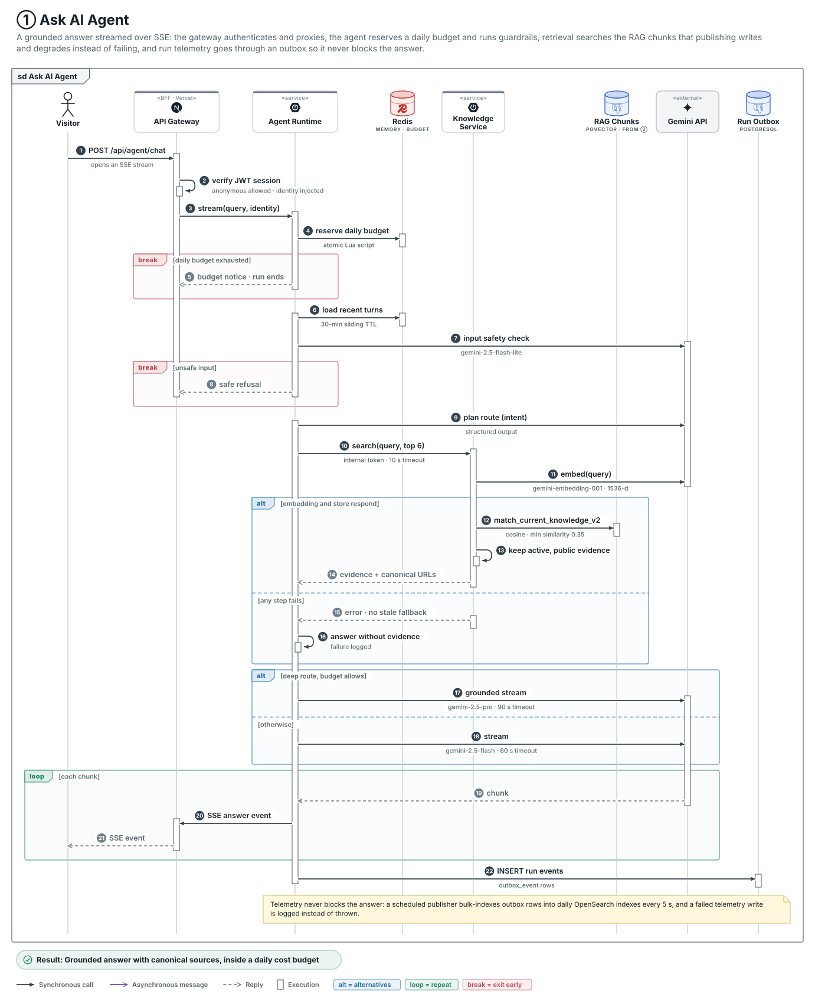
  </picture>
</p>

| # | From → To | Message | Type | Guard |
| :-: | --- | --- | :-: | --- |
| 1 | Visitor → API Gateway | **POST /api/agent/chat**<br><sub>opens an SSE stream</sub> | sync |  |
| 2 | API Gateway (self) | **verify JWT session**<br><sub>anonymous allowed · identity injected</sub> | self |  |
| 3 | API Gateway → Agent Runtime | **stream(query, identity)** | sync |  |
| 4 | Agent Runtime → Redis | **reserve daily budget**<br><sub>atomic Lua script</sub> | sync |  |
| 5 | Agent Runtime → API Gateway | **budget notice · run ends** | reply | break [daily budget exhausted] |
| 6 | Agent Runtime → Redis | **load recent turns**<br><sub>30-min sliding TTL</sub> | sync |  |
| 7 | Agent Runtime → Gemini API | **input safety check**<br><sub>gemini-2.5-flash-lite</sub> | sync |  |
| 8 | Agent Runtime → API Gateway | **safe refusal** | reply | break [unsafe input] |
| 9 | Agent Runtime → Gemini API | **plan route (intent)**<br><sub>structured output</sub> | sync |  |
| 10 | Agent Runtime → Knowledge Service | **search(query, top 6)**<br><sub>internal token · 10 s timeout</sub> | sync |  |
| 11 | Knowledge Service → Gemini API | **embed(query)**<br><sub>gemini-embedding-001 · 1536-d</sub> | sync |  |
| 12 | Knowledge Service → RAG Chunks | **match_current_knowledge_v2**<br><sub>cosine · min similarity 0.35</sub> | sync | alt [embedding and store respond] |
| 13 | Knowledge Service (self) | **keep active, public evidence** | self | alt [embedding and store respond] |
| 14 | Knowledge Service → Agent Runtime | **evidence + canonical URLs** | reply | alt [embedding and store respond] |
| 15 | Knowledge Service → Agent Runtime | **error · no stale fallback** | reply | alt [any step fails] |
| 16 | Agent Runtime (self) | **answer without evidence**<br><sub>failure logged</sub> | self | alt [any step fails] |
| 17 | Agent Runtime → Gemini API | **grounded stream**<br><sub>gemini-2.5-pro · 90 s timeout</sub> | sync | alt [deep route, budget allows] |
| 18 | Agent Runtime → Gemini API | **stream**<br><sub>gemini-2.5-flash · 60 s timeout</sub> | sync | alt [otherwise] |
| 19 | Gemini API → Agent Runtime | **chunk** | reply | loop [each chunk] |
| 20 | Agent Runtime → API Gateway | **SSE answer event** | sync | loop [each chunk] |
| 21 | API Gateway → Visitor | **SSE event** | reply | loop [each chunk] |
| 22 | Agent Runtime → Run Outbox | **INSERT run events**<br><sub>outbox_event rows</sub> | sync |  |

</details>

<a name="workflow-publish-content"></a>
<details>
<summary><b>② Publish Article</b> — One PostgreSQL transaction writes the new version, its outbox event and two indexing jobs; a relay publishes them to Kafka and wakes the scale-to-zero indexers, and independent consumers update search, RAG and subscribers at their own pace.</summary>

<p align="center">
  <picture>
    <source media="(prefers-color-scheme: dark)" srcset="public/diagrams/flow-publish-content-dark.svg">
    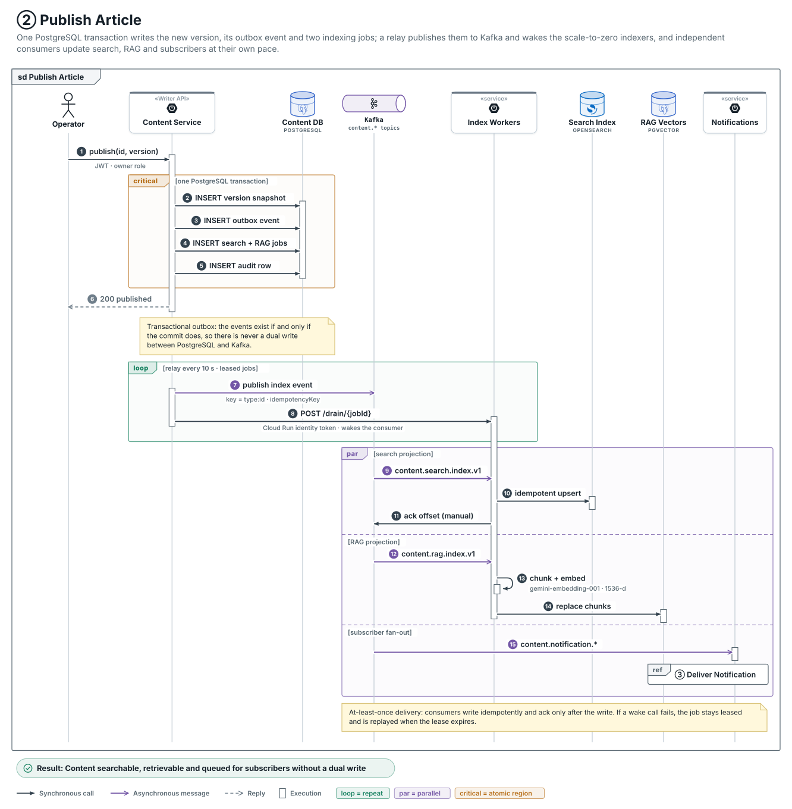
  </picture>
</p>

| # | From → To | Message | Type | Guard |
| :-: | --- | --- | :-: | --- |
| 1 | Operator → Content Service | **publish(id, version)**<br><sub>JWT · owner role</sub> | sync |  |
| 2 | Content Service → Content DB | **INSERT version snapshot** | sync | critical [one PostgreSQL transaction] |
| 3 | Content Service → Content DB | **INSERT outbox event** | sync | critical [one PostgreSQL transaction] |
| 4 | Content Service → Content DB | **INSERT search + RAG jobs** | sync | critical [one PostgreSQL transaction] |
| 5 | Content Service → Content DB | **INSERT audit row** | sync | critical [one PostgreSQL transaction] |
| 6 | Content Service → Operator | **200 published** | reply |  |
| 7 | Content Service → Kafka | **publish index event**<br><sub>key = type:id · idempotencyKey</sub> | async | loop [relay every 10 s · leased jobs] |
| 8 | Content Service → Index Workers | **POST /drain/{jobId}**<br><sub>Cloud Run identity token · wakes the consumer</sub> | sync | loop [relay every 10 s · leased jobs] |
| 9 | Kafka → Index Workers | **content.search.index.v1** | async | par [search projection] |
| 10 | Index Workers → Search Index | **idempotent upsert** | sync | par [search projection] |
| 11 | Index Workers → Kafka | **ack offset (manual)** | sync | par [search projection] |
| 12 | Kafka → Index Workers | **content.rag.index.v1** | async | par [RAG projection] |
| 13 | Index Workers (self) | **chunk + embed**<br><sub>gemini-embedding-001 · 1536-d</sub> | self | par [RAG projection] |
| 14 | Index Workers → RAG Vectors | **replace chunks** | sync | par [RAG projection] |
| 15 | Kafka → Notifications | **content.notification.*** | async | par [subscriber fan-out] |

</details>

<a name="workflow-send-notification"></a>
<details>
<summary><b>③ Deliver Notification</b> — A durable notification intent is processed idempotently in one transaction and fanned out to recipient rows; dispatchers lease rows with FOR UPDATE SKIP LOCKED so workers scale out without double-sending.</summary>

<p align="center">
  <picture>
    <source media="(prefers-color-scheme: dark)" srcset="public/diagrams/flow-send-notification-dark.svg">
    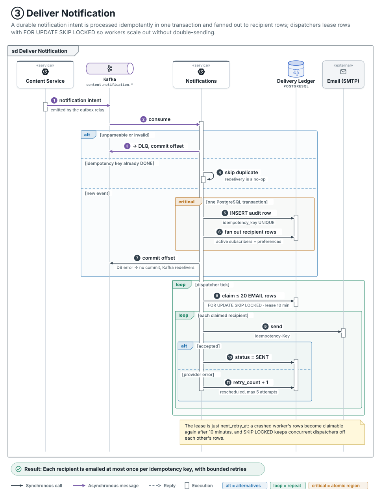
  </picture>
</p>

| # | From → To | Message | Type | Guard |
| :-: | --- | --- | :-: | --- |
| 1 | Content Service → Kafka | **notification intent**<br><sub>emitted by the outbox relay</sub> | async |  |
| 2 | Kafka → Notifications | **consume** | async |  |
| 3 | Notifications → Kafka | **→ DLQ, commit offset** | async | alt [unparseable or invalid] |
| 4 | Notifications (self) | **skip duplicate**<br><sub>redelivery is a no-op</sub> | self | alt [idempotency key already DONE] |
| 5 | Notifications → Delivery Ledger | **INSERT audit row**<br><sub>idempotency_key UNIQUE</sub> | sync | alt [new event] › critical [one PostgreSQL transaction] |
| 6 | Notifications → Delivery Ledger | **fan out recipient rows**<br><sub>active subscribers + preferences</sub> | sync | alt [new event] › critical [one PostgreSQL transaction] |
| 7 | Notifications → Kafka | **commit offset**<br><sub>DB error → no commit, Kafka redelivers</sub> | sync | alt [new event] |
| 8 | Notifications → Delivery Ledger | **claim ≤ 20 EMAIL rows**<br><sub>FOR UPDATE SKIP LOCKED · lease 10 min</sub> | sync | loop [dispatcher tick] |
| 9 | Notifications → Email (SMTP) | **send**<br><sub>Idempotency-Key</sub> | sync | loop [dispatcher tick] › loop [each claimed recipient] |
| 10 | Notifications → Delivery Ledger | **status = SENT** | sync | loop [dispatcher tick] › loop [each claimed recipient] › alt [accepted] |
| 11 | Notifications → Delivery Ledger | **retry_count + 1**<br><sub>rescheduled, max 5 attempts</sub> | sync | loop [dispatcher tick] › loop [each claimed recipient] › alt [provider error] |

</details>

<a name="workflow-track-visitor"></a>
<details>
<summary><b>④ Track Visitor</b> — A page event is rate-limited, scored and keyed at the gateway, then appended to Kafka; a batch consumer turns it into sessions and rollups exactly once in effect, and the read side serves cached aggregates with ETags.</summary>

<p align="center">
  <picture>
    <source media="(prefers-color-scheme: dark)" srcset="public/diagrams/flow-track-visitor-dark.svg">
    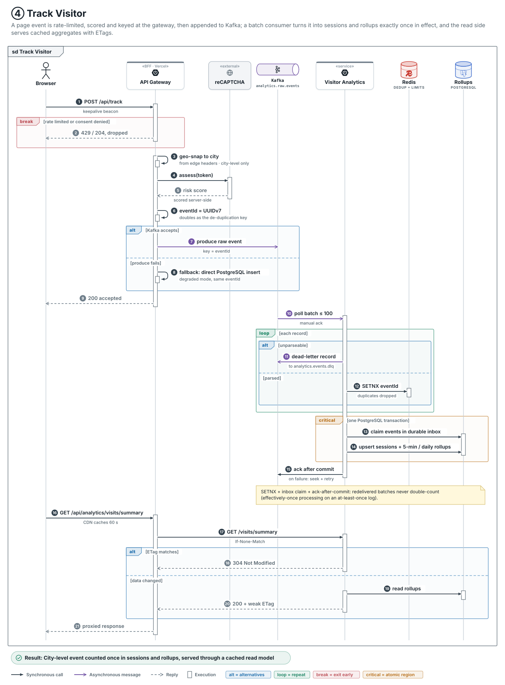
  </picture>
</p>

| # | From → To | Message | Type | Guard |
| :-: | --- | --- | :-: | --- |
| 1 | Browser → API Gateway | **POST /api/track**<br><sub>keepalive beacon</sub> | sync |  |
| 2 | API Gateway → Browser | **429 / 204, dropped** | reply | break [rate limited or consent denied] |
| 3 | API Gateway (self) | **geo-snap to city**<br><sub>from edge headers · city-level only</sub> | self |  |
| 4 | API Gateway → reCAPTCHA | **assess(token)** | sync |  |
| 5 | reCAPTCHA → API Gateway | **risk score**<br><sub>scored server-side</sub> | reply |  |
| 6 | API Gateway (self) | **eventId = UUIDv7**<br><sub>doubles as the de-duplication key</sub> | self |  |
| 7 | API Gateway → Kafka | **produce raw event**<br><sub>key = eventId</sub> | async | alt [Kafka accepts] |
| 8 | API Gateway (self) | **fallback: direct PostgreSQL insert**<br><sub>degraded mode, same eventId</sub> | self | alt [produce fails] |
| 9 | API Gateway → Browser | **200 accepted** | reply |  |
| 10 | Kafka → Visitor Analytics | **poll batch ≤ 100**<br><sub>manual ack</sub> | async |  |
| 11 | Visitor Analytics → Kafka | **dead-letter record**<br><sub>to analytics.events.dlq</sub> | async | loop [each record] › alt [unparseable] |
| 12 | Visitor Analytics → Redis | **SETNX eventId**<br><sub>duplicates dropped</sub> | sync | loop [each record] › alt [parsed] |
| 13 | Visitor Analytics → Rollups | **claim events in durable inbox** | sync | critical [one PostgreSQL transaction] |
| 14 | Visitor Analytics → Rollups | **upsert sessions + 5-min / daily rollups** | sync | critical [one PostgreSQL transaction] |
| 15 | Visitor Analytics → Kafka | **ack after commit**<br><sub>on failure: seek + retry</sub> | sync |  |
| 16 | Browser → API Gateway | **GET /api/analytics/visits/summary**<br><sub>CDN caches 60 s</sub> | sync |  |
| 17 | API Gateway → Visitor Analytics | **GET /visits/summary**<br><sub>If-None-Match</sub> | sync |  |
| 18 | Visitor Analytics → API Gateway | **304 Not Modified** | reply | alt [ETag matches] |
| 19 | Visitor Analytics → Rollups | **read rollups** | sync | alt [data changed] |
| 20 | Visitor Analytics → API Gateway | **200 + weak ETag** | reply | alt [data changed] |
| 21 | API Gateway → Browser | **proxied response** | reply |  |

</details>

<a name="workflow-execute-mcp"></a>
<details>
<summary><b>⑤ Execute MCP Tool</b> — An external AI client calls a typed tool; the edge hides the origin, the public server bounds the request and the gateway is the single policy point before any domain service is touched.</summary>

<p align="center">
  <picture>
    <source media="(prefers-color-scheme: dark)" srcset="public/diagrams/flow-execute-mcp-dark.svg">
    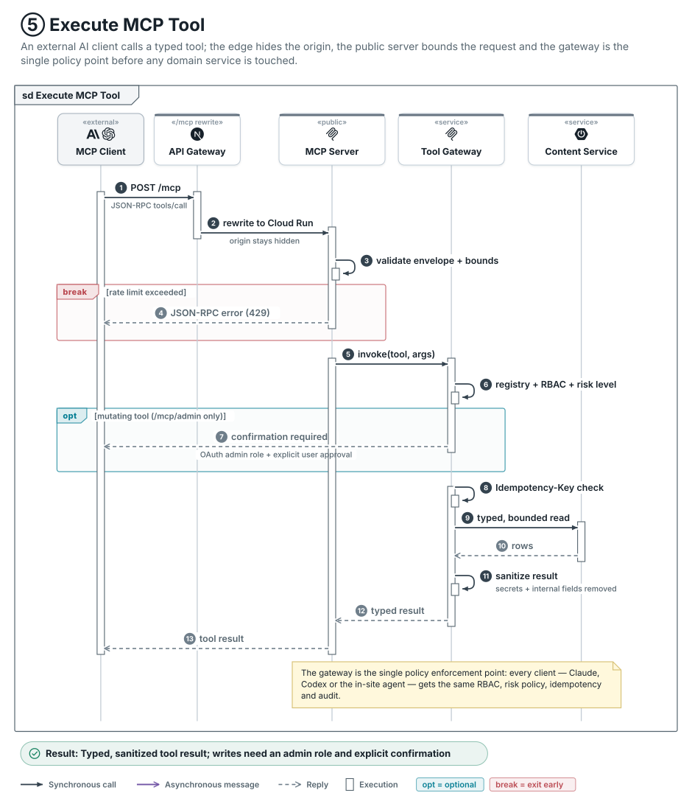
  </picture>
</p>

| # | From → To | Message | Type | Guard |
| :-: | --- | --- | :-: | --- |
| 1 | MCP Client → API Gateway | **POST /mcp**<br><sub>JSON-RPC tools/call</sub> | sync |  |
| 2 | API Gateway → MCP Server | **rewrite to Cloud Run**<br><sub>origin stays hidden</sub> | sync |  |
| 3 | MCP Server (self) | **validate envelope + bounds** | self |  |
| 4 | MCP Server → MCP Client | **JSON-RPC error (429)** | reply | break [rate limit exceeded] |
| 5 | MCP Server → Tool Gateway | **invoke(tool, args)** | sync |  |
| 6 | Tool Gateway (self) | **registry + RBAC + risk level** | self |  |
| 7 | Tool Gateway → MCP Client | **confirmation required**<br><sub>OAuth admin role + explicit user approval</sub> | reply | opt [mutating tool (/mcp/admin only)] |
| 8 | Tool Gateway (self) | **Idempotency-Key check** | self |  |
| 9 | Tool Gateway → Content Service | **typed, bounded read** | sync |  |
| 10 | Content Service → Tool Gateway | **rows** | reply |  |
| 11 | Tool Gateway (self) | **sanitize result**<br><sub>secrets + internal fields removed</sub> | self |  |
| 12 | Tool Gateway → MCP Server | **typed result** | reply |  |
| 13 | MCP Server → MCP Client | **tool result** | reply |  |

</details>

<details>
<summary><b>Detailed service topology</b> — every service, topic and state store</summary>

<p align="center">
  <a href="docs/architecture/platform-system-flow.svg">
    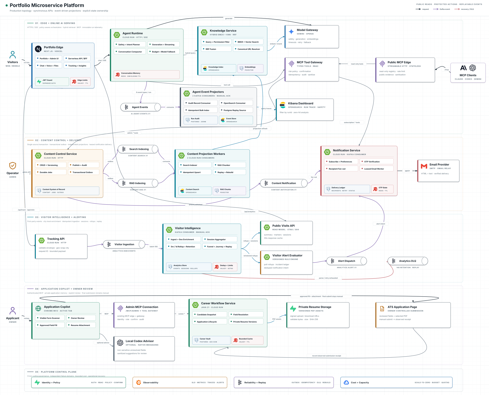
  </a>
</p>

</details>

> **Maintain these diagrams:** edit the JSON sources in [`docs/architecture/`](docs/architecture/) — topology in `platform-system-flow.json`, system overview in `platform-overview.json`, sequence diagrams in `platform-sequences.json` — then run `npm run docs:architecture`. `npm run docs:architecture:check` fails when a service is missing from the overview, a message references an unknown participant, or the generated files are stale.
<!-- architecture:end -->

---

## MCP Integrations

Connect Claude, Codex, or any Streamable HTTP MCP client to the public endpoint
at `https://www.yuqi.site/mcp`. The connector exposes read-only tools for
searching portfolio content and retrieving articles, projects, architecture,
and professional profile evidence.

**Admin MCP requires sign-in with an authorized administrator account.** Connect
to `https://www.yuqi.site/mcp/admin` and complete the sign-in and consent flow.
Authentication alone does not grant admin access: permissions are enforced by
server-managed roles. The public endpoint above remains available without sign-in.

<table align="center">
  <tr>
    <th align="center">Public MCP · Read-only</th>
    <th align="center">Admin MCP · Sign-in required</th>
  </tr>
  <tr>
    <td align="center" valign="top" width="50%">
      <a href="docs/readme-assets/claude-yuqi-portfolio-connector.png">
        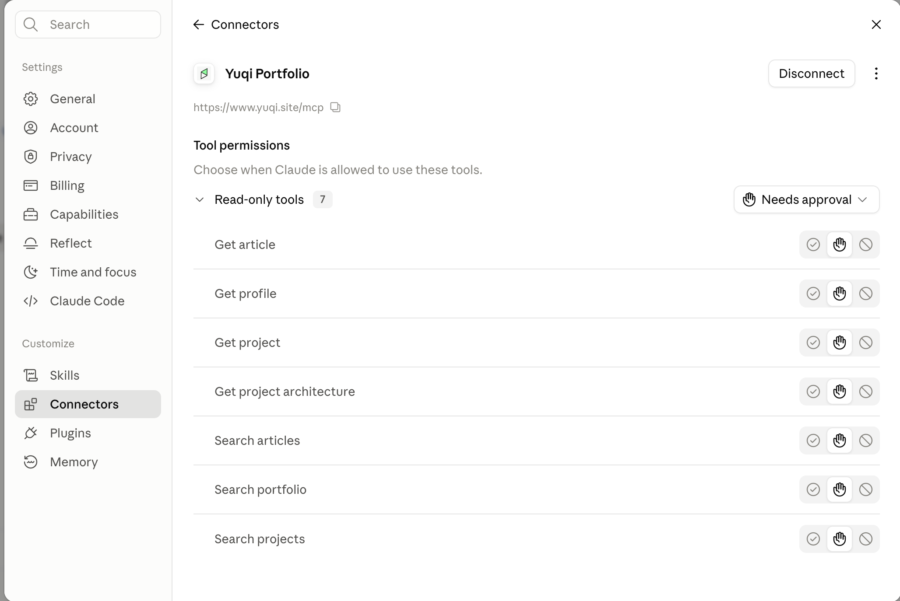
      </a>
    </td>
    <td align="center" valign="top" width="50%">
      <a href="docs/readme-assets/claude-yuqi-portfolio-admin-connector.png">
        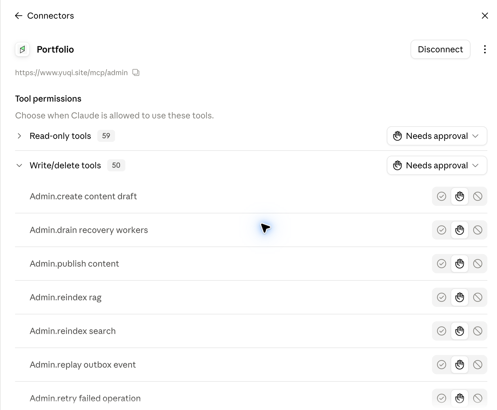
      </a>
    </td>
  </tr>
</table>

**[Read the illustrated MCP connection guide →](https://www.yuqi.site/mcp-guide)**

The guide covers client setup, public tools, example questions, and
the administrator sign-in and consent flow, with screenshots of the interfaces.

### Connect from Claude or Codex

In Claude, open **Settings → Customize → Connectors**, add a custom connector,
and use `https://www.yuqi.site/mcp` as the remote MCP server URL.

Open **+ → Plugins**, select **Yuqi Portfolio**, and ask Codex to use its tools.
For direct MCP setup:

```sh
codex mcp add yuqi-portfolio --url https://www.yuqi.site/mcp
codex mcp add yuqi-portfolio-admin --url https://www.yuqi.site/mcp/admin
```

The admin endpoint remains separately protected by sign-in, server-managed
roles, audited execution, and explicit confirmation for write operations.

<p align="center">
  <a href="public/assets/images/codex-yuqi-portfolio-plugin-v2.png">
    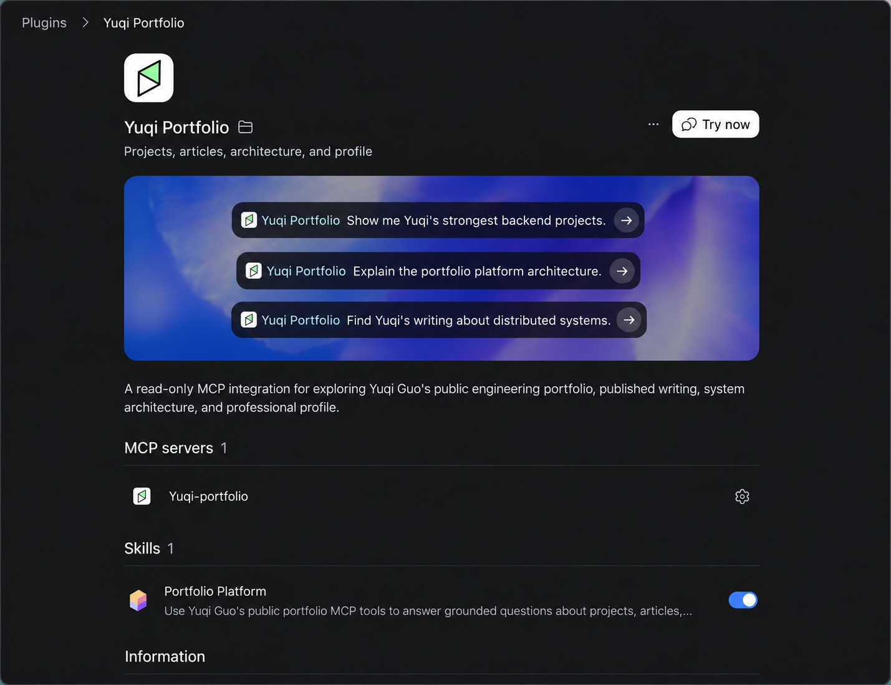
  </a>
</p>

---

## Admin Visitor Workbench

Filter traffic, switch between local time and UTC, and reuse saved views.
Inspect session timelines, classification evidence, and approximate scroll depth
at 25%, 50%, 75%, and 100% checkpoints. Visitor records require administrator access;
saved views stay in the current browser and omit visitor identifiers and free-text searches.

<p align="center">
  <a href="docs/readme-assets/visitor-view-controls-desktop.png">
    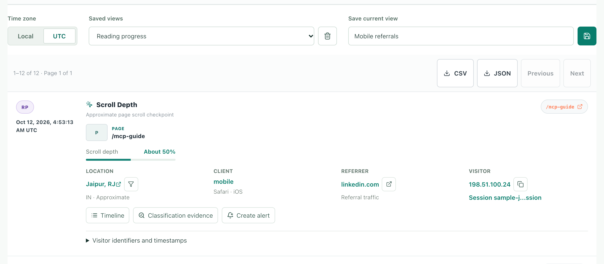
  </a>
</p>

<details>
  <summary>Mobile layout</summary>
  <p align="center">
    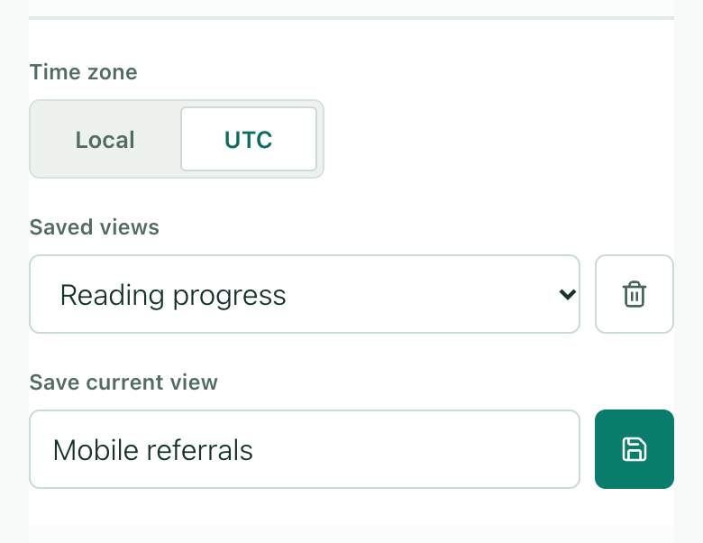
  </p>
</details>

*Screenshots use synthetic local-preview data, not real visitor records.
Scroll depth is an approximate checkpoint, not proof that content was read.*

---

## Chrome Extension: Application Copilot

Application Copilot is a Chrome Manifest V3 extension that runs directly on job
application pages. Select **Auto-fill Application**, review the resolved fields,
and apply the approved values. Resume attachment is automatic; final submission
remains manual.

<p align="center">
  <a href="https://chromewebstore.google.com/detail/yuqi-application-copilot/kgebalpnomjfemfeeiaphpaomkkccebd">
    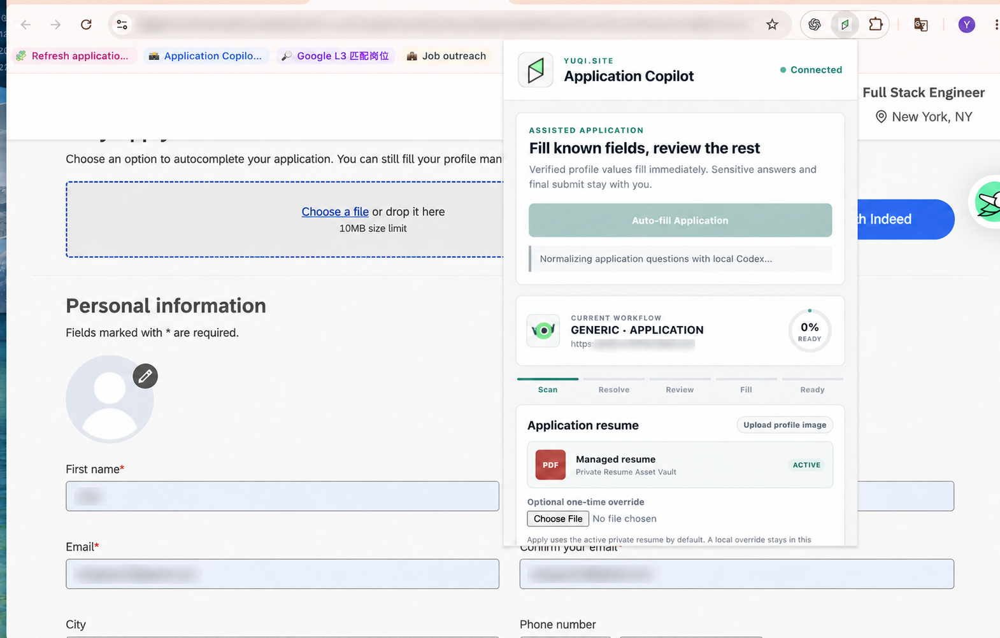
  </a>
</p>

**[Install Application Copilot from the Chrome Web Store →](https://chromewebstore.google.com/detail/yuqi-application-copilot/kgebalpnomjfemfeeiaphpaomkkccebd)**<br>
[View source code](https://github.com/YuqiGuo105/portfolio-application-copilot)

---

## Microservices GitHub Repositories

| Service                            | Repository                                                                                                | Responsibility                                                                                                |
| ---------------------------------- | --------------------------------------------------------------------------------------------------------- | ------------------------------------------------------------------------------------------------------------- |
| **Portfolio Frontend**             | [YuqiGuo105/Portfolio](https://github.com/YuqiGuo105/Portfolio)                                           | Next.js frontend, project pages, blogs, API proxy routes, chat widget, visitor globe                          |
| **Public Portfolio MCP Server**    | [YuqiGuo105/portfolio-mcp-server](https://github.com/YuqiGuo105/portfolio-mcp-server)                     | Public, read-only Streamable HTTP MCP tools for projects, articles, architecture diagrams, and profile data   |
| **portfolio-ai-platform**          | [YuqiGuo105/portfolio-ai-platform](https://github.com/YuqiGuo105/portfolio-ai-platform)                   | Agent service (safety → retrieval → generation pipeline, event observability), knowledge service (hybrid BM25+kNN, RRF, OpenAI embed), MCP gateway (typed tools, RBAC, idempotency, audit) |
| **portfolio-admin-service**        | [YuqiGuo105/portfolio-admin-service](https://github.com/YuqiGuo105/portfolio-admin-service)               | Content CRUD, optimistic concurrency, transactional outbox, Kafka publishing, OpenSearch indexer, RAG indexer |
| **portfolio-notification-service** | [YuqiGuo105/portfolio-notification-service](https://github.com/YuqiGuo105/portfolio-notification-service) | Subscription APIs, notification dispatch, email sender worker, retry handling, delivery tracking              |
| **portfolio-analytics-platform**   | [YuqiGuo105/portfolio-analytics-platform](https://github.com/YuqiGuo105/portfolio-analytics-platform)     | Spring Boot Kafka batch consumer, UA/IP/geo enrichment, Valkey dedup, pre-aggregated 5m + 1d rollups, public visits API, alerts service |
| **portfolio-application-copilot**  | [YuqiGuo105/portfolio-application-copilot](https://github.com/YuqiGuo105/portfolio-application-copilot)   | Chrome MV3 assisted application UI, MCP career workflow, encrypted application memory, and private resume vault |

---

## Features

* **Modern portfolio frontend** built with Next.js, including projects, blogs, CV, parallax project detail pages, and guided navigation.
* **AI chat assistant** with RAG retrieval, multi-round reasoning, intent classification, and MCP tool execution.
* **Public MCP integration** that gives ChatGPT, Claude, GitHub Copilot, Cursor, and other MCP clients read-only access to projects, articles, stored architecture diagrams, and public profile data.
* **Application Copilot** that combines an authenticated Chrome extension, MCP workflow, deterministic field resolution, private resume assets, and explicit review before any sensitive field is applied.
* **Admin dashboard** for managing blogs, projects, life posts, and portfolio content.
* **Kafka-driven content pipeline** that publishes content change events to search, RAG, and notification consumers.
* **Professional search stack** using OpenSearch for indexed portfolio search and ranking.
* **RAG indexing pipeline** using embeddings stored in Supabase PostgreSQL with pgvector.
* **Notification system** with subscription management, dispatch service, email sender worker, retry handling, and delivery tracking.
* **Supabase backend** for PostgreSQL, pgvector, storage, RLS policies, and server-side API integration.
* **3D geospatial visitor globe** and a real-time `/analytics` dashboard powered by a Kafka → Spring Boot aggregator pipeline (Valkey dedup, pre-aggregated `geo_time_rollups`, public visits API).
* **SEO support** with reusable metadata, `robots.txt`, and `sitemap.xml`.

---

## Getting Started

Follow these steps to run the frontend locally.

### Prerequisites

* Node.js
* npm

Install the latest npm globally if needed:

```sh
npm install npm@latest -g
```

### Installation

Clone the repository:

```sh
git clone https://github.com/YuqiGuo105/Portfolio.git
cd Portfolio
```

Install dependencies:

```sh
npm install
```

Start the local development server:

```sh
npm run dev
```

Open the application at:

```txt
http://localhost:3000
```

To open the chat widget automatically, append `?openChat=1`:

```txt
http://localhost:3000/?openChat=1
```

---

## Environment Variables

Copy `.env.example` to `.env.local` and fill in your values:

```sh
cp .env.example .env.local
```

See [`.env.example`](.env.example) for the core variables. Feature-specific settings are documented alongside each service. For production, configure the same variables in **Vercel → Project Settings → Environment Variables**.

Score-based bot detection uses Google reCAPTCHA Enterprise and degrades to the
existing server-side heuristic when it is not configured or temporarily
unavailable:

```txt
NEXT_PUBLIC_RECAPTCHA_SITE_KEY=<score-based site key>
RECAPTCHA_PROJECT_ID=<Google Cloud project id>
RECAPTCHA_API_KEY=<server-only restricted API key>
RECAPTCHA_ALLOWED_HOSTS=yuqi.site,www.yuqi.site
RECAPTCHA_TIMEOUT_MS=1500
```

Restrict the API key to the reCAPTCHA Enterprise API. Never expose
`RECAPTCHA_API_KEY` through a `NEXT_PUBLIC_` variable.

---

## Supabase Setup

1. Create a Supabase project at [app.supabase.com](https://app.supabase.com).
2. Copy the Project URL and anon public API key from **Project Settings → API**.
3. Add them to `.env` as `NEXT_PUBLIC_SUPABASE_URL` and `NEXT_PUBLIC_SUPABASE_ANON_KEY`.
4. Copy the `service_role` key and set it as `SUPABASE_SERVICE_ROLE_KEY`.
5. Open the Supabase SQL Editor.
6. Review `creat_sql.txt` and `docs/security/` before setting up the database. Do not run legacy bootstrap SQL against an existing production database.
7. Confirm that required tables, policies, and server-side access patterns are configured correctly.

---

## Usage

* Browse projects, blogs, and portfolio details.
* Use the contact form to send messages to the portfolio owner.
* Use the AI chat widget to ask questions about the portfolio.
* Use the Admin Dashboard to edit portfolio content.
* Use Supabase as the source of truth for editable content.
* Use OpenSearch for fast search experiences.
* Use Kafka consumers to keep search, RAG, and notifications in sync.

---

## SEO

This project includes basic SEO support:

* Reusable SEO metadata component
* Page-level titles and descriptions
* `robots.txt`
* `sitemap.xml`
* Production site URL configuration

---

## Contributing

Contributions are welcome. To contribute:

1. Fork the repository.
2. Create a feature branch.
3. Commit your changes.
4. Open a pull request with a clear description of the change.

---

## License

This project is available under the [MIT License](LICENSE).

Copyright (c) 2023-present Yuqi Guo.
