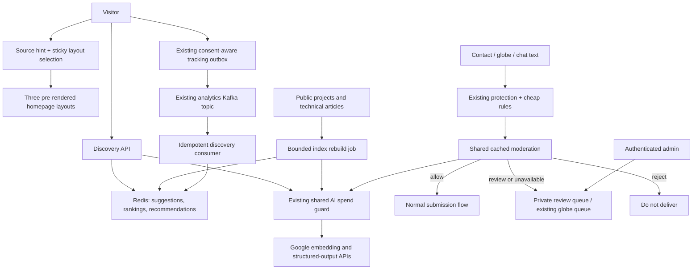

# Discovery and Submission Safety

Status: production infrastructure configured and release checks passed on November 12,
2026. The feature is disabled unless explicitly configured. Provider billing settings
and the existing $5 shared AI budget are unchanged.

## Architecture



## Behavior

| Feature | Request path | External model use |
| --- | --- | --- |
| Homepage | Referrer/UTM hint, 30-minute sticky cookie, static rewrite | None |
| Typeahead | 250ms debounce, public titles and frequent safe query phrases | None |
| Read next | Prefetch within 700px, three cached content IDs rejoined to public catalog | None at page view |
| Submitted search | Keyword/vector reciprocal-rank fusion, top-eight reranking | Cache misses only |
| Moderation | Rules, one-hour classification cache, uncertain result held privately | One bounded structured-output request |

Homepage source is a hint, not a claim that the visitor is a recruiter or engineer.
Hero and all existing content remain present. LinkedIn defaults to experience and
projects; GitHub defaults to projects and technical writing, with architecture-enabled
projects first. An epsilon-greedy experiment explores 10% of visits and only adopts
a learned winner after each layout has 30 eligible sessions in that source cohort.
DNT, GPC, opt-out cookies and known crawler user agents receive the original layout.

The local catalog is deliberately limited to public projects and technical articles,
read through anonymous RLS. Life articles and experience can still appear as metadata
in All search through the existing public search API; they are not added to this
new embedding index. Public catalog refresh is at most 60 seconds, so publication
revocation has that cache window. Detail-page authorization remains authoritative.

The reranker is a small structured-output LLM call, not a trained cross-encoder.
The moderation score is a heuristic, not a calibrated probability or complete
security boundary. Existing Turnstile, rate limits, MCP authentication and agent
tool permissions remain in force. Links and phone numbers in legitimate contact
messages are not blanket-blocked; globe notes retain their stricter existing rules.

## Cost and Performance Controls

- `gemini-2.5-flash-lite` for moderation/reranking, with thinking disabled and
  300/500 output-token caps; `gemini-embedding-2` at 768 dimensions for vectors.
- Every paid request reserves its conservative quote through the existing shared
  monthly ledger **before** calling Google. Ambiguous failures retain their
  reservation. No paid automatic retries or more-expensive fallback model.
- Query embeddings: one hour; ranked search: 15 minutes; document embeddings:
  30 days keyed by text hash; recommendation snapshots: two days.
- Rebuild: at most 20 new embedding attempts and a four-minute admission window
  per pass. Changed content continues in the next scheduled pass; existing vectors
  are reused. A ten-minute Redis lease prevents normal overlapping rebuilds.
- Each Google request has a five-second network deadline; spend reservation and
  settlement each have their existing 3.5-second deadline. Those are separate
  phases: five seconds is **not** an end-to-end API latency guarantee.
- Homepage policy has an 80ms deadline and a five-minute in-process cache. A miss
  retains the source-aware default. Static rewrites avoid client-side reorder jumps.
- Search is limited to ten requests/minute/IP; other discovery reads to 90.
  Moderation uses the existing channel limits and a separate chat limit.
- Keyword search survives model outage; recommendations fall back to lexical
  similarity. Cache/API failures leave the page usable; uncertain moderation is
  held for review rather than sent or published.

No new GPU, model training job or paid API subscription is required. Infrastructure,
storage and network costs are separate from model-token costs. Validate actual
production latency and Redis load before enabling broadly.

## Feedback and Privacy

The hourly, scale-to-zero Cloud Run Job consumes the existing analytics topic, not an additional browser stream.
It ignores denied consent, known bots, invalid event IDs and events older than a day.
One Redis CAS commits aggregate changes and idempotency receipts before the Kafka
offset is acknowledged. Issued result IDs constrain click attribution. Co-visits
count once per session/pair/day and influence ranking only after three observations.
Attribution records last 26 hours to cover delayed batch processing. A worker pass
consumes for up to 30 seconds / 1,000 events, with a ten-minute overlap lease. It
rebuilds the index and cleans expired review rows once per UTC day; deferred index
batches continue in subsequent passes. Failed embedding calls wait until the next
day. No permanent consumer or minimum instance is required.

Learning state rotates after 30 days. Event receipts last two days; session working
sets last 30 minutes. Receipt/day capacity is bounded; reaching it pauses learning
instead of discarding live deduplication receipts. This learning projection is not
the authoritative visitor evidence store. It can undercount late, out-of-order or
filtered activity; do not use it as an audit proof or identity classifier.

Only phrases entirely composed of public catalog vocabulary, without email/URL/
long-number patterns, can become query suggestions, after five session/day
observations. Raw queries, IPs and referrers are not written to learning state.
Submitted search text is still sent to Google when semantic search is explicitly run.

Moderation sends message text to Google after redacting common email/phone patterns.
It does not send separate contact name/email fields. This is not complete PII
anonymization: other personal details typed into text can remain. Production privacy
disclosures must cover this processing before activation.

Uncertain contact/chat submissions are private, RLS-protected and expire after
30 days. Globe review uses the existing flag table. Contact approval claims a row
atomically before sending; ambiguous mail delivery is marked `delivery_unknown`
and never automatically resent. Reviewing chat does not replay agent actions.
The daily maintenance job must run for physical deletion of expired queue rows.

Click-through and clicked reciprocal rank are diagnostic proxies, not labelled MRR.
Source signals and client telemetry are spoofable; they never grant authorization.

## Local Preview

```sh
PORT=3146 DISCOVERY_ENV_FILE=/absolute/path/to/local.env \
  DISCOVERY_AI_ENABLED=1 node scripts/dev-discovery.mjs --detach
```

Open `http://127.0.0.1:3146/admin/discovery-preview`.
The launcher uses an isolated in-memory store/review queue and blocks ordinary write
APIs, including email and globe posting. Public content is read-only; Google calls
still use the shared budget ledger. Restarting clears preview data. Rebuild the
index once, compare source layouts, try search, and check synthetic submissions.
The preview's approval button never sends mail. Synthetic session events exercise
the same aggregation function twice to demonstrate duplicate handling without
writing live analytics.

## Production Configuration

1. Review and apply `20261112184443_content_review_queue.sql`; verify anon and
   authenticated roles cannot read rows or execute transitions.
2. Configure `DISCOVERY_REDIS_URL` (TLS in production),
   `DISCOVERY_GOOGLE_API_KEY` (or existing `GEMINI_API_KEY`), public Supabase configuration and server-only review
   and spend credentials. Never expose the service key or Google key to clients.
3. Deploy `services/discovery/Dockerfile` as `portfolio-discovery` in
   `portfolio-notify-prod/us-central1`: 1 CPU, 512 MiB (Jobs minimum), one task, five-minute
   timeout, zero automatic retries. Its dedicated identity reads only the seven
   required existing secrets. Group `portfolio-discovery-v1` starts at new events.
4. Schedule the IAM-authenticated job execution hourly (`17 * * * *`, UTC).
   The same short job performs daily indexing and queue retention. It has no
   public HTTP endpoint and does not rely on background CPU after a response.
5. Review privacy wording, provider data handling, live rates and shared ledger
   configuration. Check sample decisions and approval behavior with admin access.
6. Enable `DISCOVERY_ENABLED=1`, `DISCOVERY_AI_ENABLED=1` and build-time
   `NEXT_PUBLIC_DISCOVERY_ENABLED=1` together. Never set `DISCOVERY_PREVIEW` in
   production. Inspect cache health, backlog and model spending after a small rollout.
7. Roll back by disabling discovery flags and rebuilding; old search/contact/globe
   behavior remains available. Review/retain any existing pending submissions.

## Verification

```sh
npm run test:discovery
npm test
DISCOVERY_PGLITE_MODULE=/absolute/path/to/@electric-sql/pglite/dist/index.js \
  npm run test:discovery
DISCOVERY_ENV_FILE=/absolute/path/to/local.env node scripts/build-discovery.mjs
```

The SQL test uses real PostgreSQL semantics in PGlite when its optional module path
is supplied; otherwise it is explicitly skipped. Unit tests cover ranking, caching,
revocation, budget denial, Kafka retry consumption, consent/bot exclusion, atomic
review, unknown email outcome and outage handling. Live Google smoke checks verified
benign/spam classification, 768-dimensional embedding and reranking. Full live
Kafka/Redis infrastructure integration uses a separate verification topic with one-hour
retention and one-hour Redis test keys. Four duplicate deliveries produced two receipts,
one co-visit pair, and committed offsets; no visitor log was written. Production admin
access is enforced by the existing administrator guard.

Release verification:

- Review migration applied with RLS; anonymous/authenticated roles cannot read or
  transition review records. The service role retains backend access.
- Both a direct job execution and an actual Scheduler-triggered execution succeeded.
  Ten public documents produced ten vectors, with zero unavailable/deferred items.
  The second run reused daily maintenance and made no new embedding requests.
- Production-environment checks returned three recommendations, seven hybrid/reranked
  project search results, 401 for anonymous review access, and 404 for preview routes.
  Abusive chat was rejected; an unverified contact request could not send mail.
- LinkedIn/GitHub layouts and DNT fallback matched their server-rendered section order.
  Sample round-trip times were 0.17-0.18 seconds for cached home layouts, 0.43 seconds
  for recommendations and 3.16 seconds for an uncached hybrid/reranked search. These
  are individual observations, not latency guarantees.
- The initial ten embeddings reserved/settled $0.021726 in the conservative shared
  ledger. This is not an invoice measurement; infrastructure is billed separately.
- Discovery, contact, security, OAuth, browser-action, budget and voice regression
  suites passed, as did the existing 367-test suite and isolated production build.

Official references: [Google pricing](https://ai.google.dev/gemini-api/docs/pricing),
[embeddings](https://ai.google.dev/gemini-api/docs/embeddings),
[structured output](https://ai.google.dev/gemini-api/docs/structured-output).
