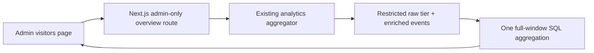

# Visitor Overview: Local Review

Status: implementation reviewed locally; owner authorized direct commits and production release on 2026-10-11. Release verification is tracked separately. No new infrastructure or database migration is required.

## Experience

- A compact overview above the existing visitor records, intelligence and alerts.
- The overview can be collapsed as a whole. Metrics, trend, composition and each ranking also have independent keyboard-accessible disclosures. Collapse state survives filter/range changes within the current page, does not trigger requests and does not reset the selected chart metric. All sections start expanded on a fresh page load.
- Rolling 24-hour, 7-day and 30-day windows; hourly or daily UTC buckets.
- Events, page views, distinct session IDs and known countries.
- Interactive trend: switch between events, page views and sessions; inspect points by mouse, touch or keyboard.
- Traffic composition: likely people, bots and unclassified events. A non-bot flag is not proof of a human.
- Top pages (page views), referrer domains, countries and devices (events).
- Ranking selections add to the existing filters. Filters and the exact time window are shared with records and exports. Page/referrer filters retain the existing substring-match semantics. Home, Direct and Unknown are non-clickable because those values cannot be represented faithfully by those filters.
- Explicit loading, empty and retryable error states. An older response cannot overwrite a newer filter.

## Data Flow

The new `/api/admin/visitor-overview` route uses the existing admin identity check, internal service token, `private, no-store` response policy and a 12-second proxy timeout. The aggregator reuses `VisitorQueryService.buildWhere` so the overview and record query share parameterized filters, site isolation, loopback exclusion, admin-page exclusion and bot semantics.

The read-only query has an 8-second transactional timeout, at most 31 days, and at most five rows per ranking. It uses existing site/time indexes and returns only aggregates, not raw IPs, session IDs, referrer query strings or coordinates. Distinct sessions exclude missing session IDs and are not unique people. Empty time buckets are filled with zero; first/last buckets may be partial. Raw data retention limits coverage. No prior-period growth percentage is fabricated beyond retained data.

No warehouse, scheduled job, charting dependency or always-on instance is added. The overview loads on filter/range changes or refresh, not on record pagination; it does not poll.

## Local Preview

`http://127.0.0.1:3111/admin/visitor-preview`

This development-only page uses deterministic sample events, clearly labeled in its banner. It renders the same workspace as the authenticated admin page, but does not read production visitors. Its alert changes remain in browser memory. Release the updated aggregator before the frontend. The sample preview remains unavailable in production.

## Verification

- `node --test tests/visitor-workbench*.test.mjs`: aggregation parity, bot filters, authorization, sanitized errors, empty/retry states, request cancellation and prior visitor workbench tests.
- `npm run test:security`: existing admin boundary suite.
- `PLAYWRIGHT_MODULE=<playwright-module> VISITOR_PREVIEW_URL=http://127.0.0.1:3111 node tests/visitor-overview.browser.mjs`: 1440, 1024, 390 and 320px; range/metric switches, chart keyboard navigation, classification, drilldown, reset, empty states, no horizontal overflow or external data requests.
- Existing `tests/visitor-workbench.browser.mjs`: map links, copy, saved views, session pagination, classification and in-memory alert confirmation at three widths.
- Aggregator Java tests: `VisitorOverviewTest`, `VisitorQueryServiceTest`, `AdminVisitorsControllerTest`, `AdminTokenFilterTest`.
- `BehaviorEventAccessPostgresTest` exercises the actual HTTP controller, auth filter, JDBC query and Flyway-managed PostgreSQL schema in the isolated CI database, including aggregate-only responses and record/filter parity.
- Aggregator `scripts/test-visitor-overview-sql.mjs`: executes the actual SQL resource against local PGlite PostgreSQL with 150 synthetic events, including time boundaries, empty buckets, bot states, sessions, URL cleanup and site isolation. PGlite is a temporary test tool, not an application dependency.

Screenshots are under `test-artifacts/visitor-overview/` (git-ignored). Local preview tests use fixtures; they are not evidence of production data delivery. The release check must separately verify the authenticated frontend-to-aggregator route, unauthenticated denial, and the exact deployed commits. The public MCP tools and public analytics privacy limits remain unchanged.
